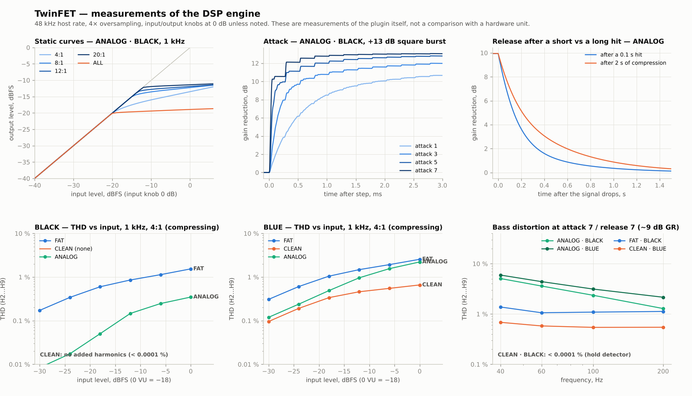
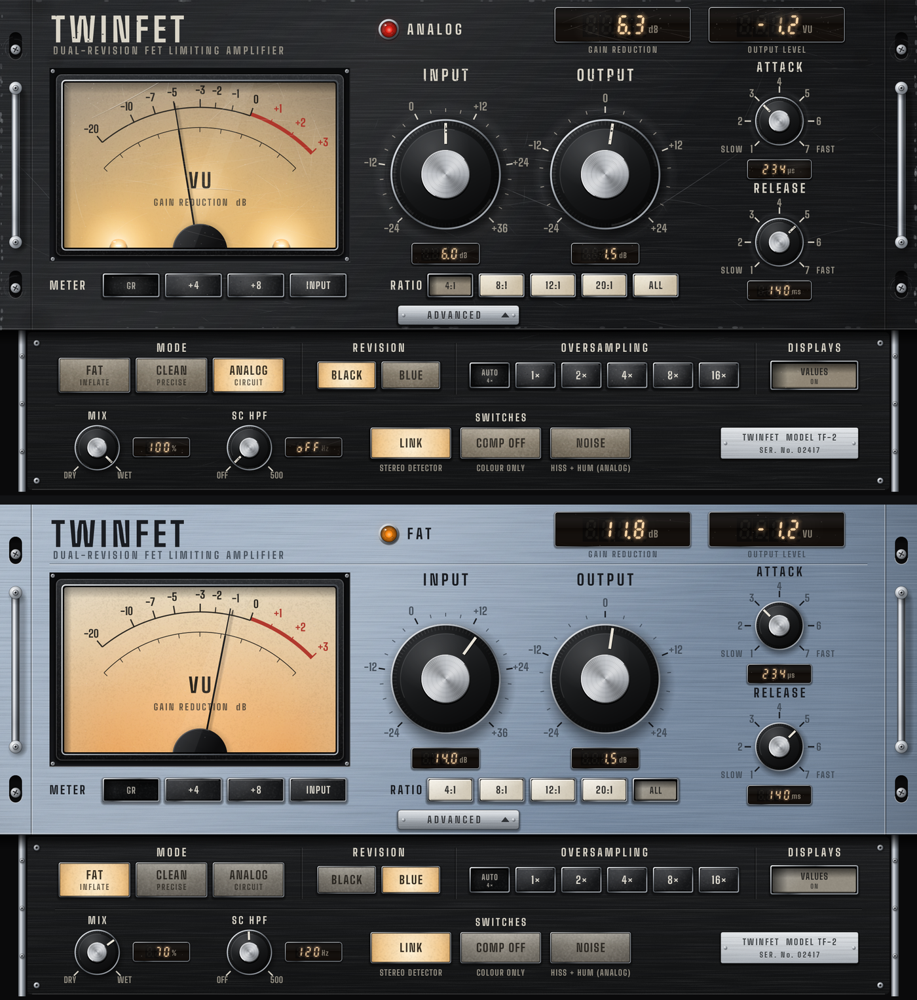

# TwinFET — FET-компресор у стилі 1176 (VST3 / AU / Standalone)

Дві ревізії — **BLACK** (blackface, LN) і **BLUE** (bluestripe, більше насичення) — та три режими роботи:

| Режим | BLACK | BLUE |
|---|---|---|
| **1 · FAT** — лінійний, «роздуває» звук у дусі CLA-76 | лінійна компресія + щільність («inflate»), парні й непарні гармоніки, трохи ваги на низу | те саме, але гарячіше: більше гармонік, сильніше «роздування», легкий підйом верху |
| **2 · CLEAN** — лінійний, точний | **жодного насичення** (гармоніки < 0.0001 %), бас не спотворюється навіть на 7/7 | **дороге насичення**: клас-А каскад + трансформатори, домінує 2-га гармоніка, гармоніки швидко згасають |
| **3 · ANALOG** — нелінійна модель схеми | модель LN-ревізії | модель bluestripe (FET-підсилювачі, ~5 дБ гарячіше, більше 2-ї гармоніки) |



---

## Що саме моделюється в ANALOG

- **Сайдчейн зі зворотним зв'язком**: детектор бачить сигнал *після* FET, як у залізі. Петля розв'язується неявно на кожному семплі (стабільно на будь-яких налаштуваннях).
- **Випрямляч + накопичувальний конденсатор без «згладжування»**: на атаці/відновленні 7/7 бас спотворюється (≈5 % THD на 40 Гц при ~9 дБ GR) — та сама «бруднуватість» 1176 на швидких налаштуваннях. На повільних — значно чистіше.
- **Програмозалежне відновлення**: після короткого удару — швидке, після довгої компресії — повільний «хвіст».
- **Відновлення лінійне в децибелах** (розряд конденсатора керує FET-ом), а не просто експонента.
- **FET-спотворення**, що росте з глибиною подавлення; у BLUE — сильніше; в ALL — у рази більше.
- **Передпідсилювач** (BLACK — малошумний біполярний, BLUE — FET, на ~5 дБ гарячіший), **лінійний підсилювач класу А** (ручка OUTPUT реально його драйвить — як на залізі, «більше Output = більше бруду»), **вхідний і вихідний трансформатори** (насичення магнітного потоку: низ насичується першим).
- **ALL buttons**: ~16:1 і більше з «плато», зміщення робочих точок, лаг атаки на транзієнтах (удари «вибухають»), значно більше спотворень.
- Пороги залежать від ratio (як в UREI: вищий ratio — вищий поріг): 4:1 −18 dBFS, 8:1 −14, 12:1 −13, 20:1 −12, ALL −20 (при INPUT = 0 дБ; 0 VU = −18 dBFS).
- Атака 20 мкс…800 мкс, відновлення 50 мс…1,1 с; **7 — найшвидше**, як на залізі.
- Опційно: шум і фон (кнопка NOISE).

### Звірка з паспортом 1176LN (BLACK)

Модель BLACK відкалібровано під опубліковані характеристики LN-версії; BLUE (рання ревізія) навмисно брудніша й шумніша.

| Паспорт 1176LN | ANALOG · BLACK (виміряно) | ANALOG · BLUE |
|---|---|---|
| THD з лімітуванням < 0,5 % (50 Гц…15 кГц, release 1,1 с) | 0,19–0,37 % (4:1 і 20:1, ~6–9 дБ GR) | 1,4–1,9 % |
| +22 dBm на виході при THD ≤ 0,5 % | 0,36 % на +21 dBm (1 кГц) | ≈2 % |
| S/N > 81 дБ (вхід на порозі, NOISE увімк.) | 82 дБ | 74 дБ |
| АЧХ ±1 дБ 20 Гц…20 кГц | −1,0 дБ на 20 Гц, −0,5 дБ на 20 кГц | −1,2 / −0,6 дБ |
| Атака 20…800 мкс, відновлення 50 мс…1,1 с | в межах точності вимірювання | те саме |

Тут 0 dBFS = +22 dBm, 0 VU (+4 dBm) = −18 dBFS. Порогів для кожного ratio і кривих стиснення в паспорті немає, тому вони взяті з опису схеми (поріг задається зміщенням детектора, вищий ratio — вищий поріг).

У FAT і CLEAN детектор **лінійний** (feed-forward, точна крива, ті самі пороги й часи), тому ці режими передбачувані й однаково поводяться на будь-якому матеріалі.

## Керування

| Елемент | Що робить |
|---|---|
| INPUT | наскільки сильно сигнал «вдавлюється» у фіксований поріг (−24…+36 дБ) |
| OUTPUT | гучність на виході (−24…+24 дБ); в ANALOG ще й драйвить вихідний підсилювач |
| ATTACK / RELEASE | 1…7, 7 — найшвидше |
| RATIO | 4, 8, 12, 20, ALL |
| METER: GR / +4 / +8 / INPUT | що показує VU-метр (+4: 0 VU = −18 dBFS, +8: 0 VU = −14 dBFS) |
| **ADVANCED** (металева планка під ручками) | висуває/ховає нижню панель з усім, що нижче |
| ↳ MODE | FAT · CLEAN · ANALOG (перемикання без клацань — 30 мс кросфейд); поточний режим видно й на головній панелі (лампа + назва) |
| ↳ REVISION | BLACK / BLUE |
| ↳ OVERSAMPLING | AUTO (4× до 50 кГц, 2× до 100 кГц) · 1× · 2× · 4× · 8× · 16× |
| ↳ DISPLAYS: VALUES | показати/сховати всі цифрові індикатори — лишаються тільки ручки й стрілка |
| ↳ MIX | паралельна компресія; сухий сигнал іде тими самими фільтрами, тож фаза вирівняна |
| ↳ SC HPF | фільтр низу в сайдчейні (Off…500 Гц) |
| ↳ LINK | стерео-лінк детекторів |
| ↳ COMP OFF | лише колір схеми, без компресії (як «Attack Off») |
| ↳ NOISE | шум/фон заліза (лише ANALOG) |

Стан ADVANCED і VALUES зберігається разом із проєктом.

### Оверсемплінг

Насичення й «роздування» створюють гармоніки, які без оверсемплінгу заверталися б у чутний діапазон. Виміряно на гарячому тоні 9,1 кГц (найгірша негармонійна складова, 48 кГц):

| | 1× | 2× | 4× | 8× | 16× |
|---|---|---|---|---|---|
| аліасинг (FAT·BLUE / ANALOG·BLUE) | −29 / −33 дБ | −93 дБ | −102 / −105 дБ | −102 / −106 дБ | −101 / −106 дБ |
| затримка, семплів | 0 | 3 | 4 | 5 | 5 |
| CPU (одне ядро, стерео) | ≈0,5 % | ≈1 % | ≈2–3 % | ≈4–5 % | ≈9 % |

Тобто 4× (і AUTO на 44,1/48 кГц) — уже практично ідеально; 8× і 16× є для спокою душі. Під час перемикання звук на мить вимикається (рушій перебудовується, затримка повідомляється DAW).

Кожна кнопка й ручка підписана на панелі, під ручками — цифрові індикатори значень, внизу — індикатори GAIN REDUCTION і OUTPUT LEVEL. Точне значення (наприклад, «3.0 (234 µs)») показується і в спливаючій підказці, поки крутите ручку. Підказки (tooltips) українською — наведіть мишку на елемент. Подвійний клік по ручці повертає значення за замовчуванням. Вікно масштабується (70–200 %), тягніть за правий нижній кут.

### Як виглядає



- **Ревізія змінює сам корпус**: BLACK — чорний анодований брашований алюміній зі світлими написами, BLUE — сріблясто-блакитний анодований алюміній з темними написами.
- **Режим змінює підсвітку**: FAT — бурштинова, CLEAN — холодно-біла (дві лампи по кутах шкали); **ANALOG — одна лампа розжарювання за серединою шкали**, кристал червоний.
- **ANALOG = «прилад, що пожив»**: подряпини, затерта фарба навколо ручок і по краях вух, сліди від гвинтів стійки, стерті написи, бруд у кутах, пожовклий папір шкали, потерті кнопки й лінзи, «вичовгані» ручки. В FAT/CLEAN панель нова.
- **Кнопки різні**: RATIO — білі, METER та OVERSAMPLING — чорні (без підсвітки; натиснута кнопка «провалюється» і темнішає), MODE/REVISION/перемикачі — з лампою під матовою лінзою.
- **Металеві деталі**: хромовані ручки стійки, хромові рамки кнопок і дисплеїв, полірований обідок на ручках, гвинти по кутах VU і висувної панелі, напрямні «шухляди», гравірована табличка.
- **Цифрові індикатори** — семисегментні LED-модулі за тонованим склом у металевій рамці (видно й непідсвічені сегменти «8.8.8»; на склі трохи пилу й волосяних подряпин, у ANALOG — більше, деякі сегменти «втомлені»): атака показується в мікросекундах, відновлення — в мілісекундах, вхід/вихід у дБ, SC HPF — у Гц або «oFF»; одиниці надруковані на склі. Коли на виході тиша, OUTPUT LEVEL показує «---».
- Текстури (брашований метал, матові лінзи кнопок, папір шкали) генеруються під реальну щільність пікселів екрана, тож на 4K/Retina не розмиваються.

---

## Як отримати готовий VST3

### Варіант А — без встановлення нічого (GitHub Actions)

1. Створіть репозиторій на github.com (можна приватний).
2. Завантажте **весь вміст** архіву, разом із прихованою папкою `.github` (найпростіше — через GitHub Desktop або `git push`; у веб-інтерфейсі перетягніть усі папки).
3. Відкрийте вкладку **Actions** — збірка запуститься сама (10–20 хв).
4. Унизу сторінки запуску завантажте артефакт **TwinFET-Windows** (або macOS / Linux).

Усередині архіву **TwinFET-Windows**:

| Файл | Що це |
|---|---|
| `TwinFET-Setup-Windows.exe` | **інсталятор** — сам кладе плагін куди треба (рекомендовано) |
| `TwinFET.vst3` | **один файл (DLL)** — для ручного встановлення: просто киньте в папку VST3 |
| `Standalone\TwinFET.exe` | окрема програма, працює без DAW |
| `README.md` | ця інструкція |

### Варіант Б — локально на Windows

Потрібні: Visual Studio 2022 (або новіша) з компонентом «Desktop development with C++», CMake 3.22+ і Git (JUCE завантажиться автоматично).

```bat
cmake -B build
cmake --build build --config Release
```

Готовий плагін: `build\TwinFET_artefacts\Release\VST3\TwinFET.vst3`

### macOS

Xcode Command Line Tools + CMake:

```sh
cmake -B build -DCMAKE_BUILD_TYPE=Release -DCMAKE_OSX_ARCHITECTURES="arm64;x86_64"
cmake --build build --config Release
```

Отримаєте VST3, AU (`TwinFET.component`) і Standalone.

### Linux

Потрібні пакети: `libasound2-dev libjack-jackd2-dev libfreetype-dev libfontconfig1-dev libx11-dev libxcomposite-dev libxcursor-dev libxext-dev libxinerama-dev libxrandr-dev libxrender-dev libglu1-mesa-dev`, далі як на macOS (без `CMAKE_OSX_ARCHITECTURES`).

Якщо JUCE вже є локально: `cmake -B build -DJUCE_PATH=/шлях/до/JUCE`.

## Встановлення

### Windows

**Інсталятор (найпростіше):** запустіть `TwinFET-Setup-Windows.exe` → Далі → Встановити. Плагін ляже в `C:\Program Files\Common Files\VST3\TwinFET.vst3` (туди дивляться всі DAW), за бажанням — ще й окрема програма зі значком у меню «Пуск». Видаляється як звичайна програма (Параметри → Програми). Повторний запуск нової версії просто замінює стару.

Інсталятор не підписаний сертифікатом, тому Windows SmartScreen може показати «Windows захистив ваш ПК» — натисніть **Докладніше (More info)** → **Усе одно запустити (Run anyway)**.

**Вручну, одним файлом:** скопіюйте `TwinFET.vst3` (це один файл-DLL) у `C:\Program Files\Common Files\VST3\` (Windows попросить права адміністратора — погодьтеся).

Далі в DAW перескануйте плагіни (FL Studio: *Options → Manage plugins → Find installed plugins*; Ableton: *Options → Preferences → Plug-ins → Rescan*; Reaper: *Options → Preferences → VST → Re-scan*). Перед оновленням плагіна закрийте DAW, інакше Windows не дасть замінити файл.

Якщо збираєте самі (варіант Б): `cmake --build build --config Release`, потім інсталятор — [Inno Setup 6.3+](https://jrsoftware.org/isinfo.php): `ISCC /DArtefacts=build\TwinFET_artefacts\Release installer.iss` (результат у `dist\`).

### macOS / Linux

- **macOS**: `TwinFET.vst3` → `~/Library/Audio/Plug-Ins/VST3/`, `TwinFET.component` → `~/Library/Audio/Plug-Ins/Components/`. Збірка не підписана, тому один раз виконайте:
  `xattr -dr com.apple.quarantine ~/Library/Audio/Plug-Ins/VST3/TwinFET.vst3 ~/Library/Audio/Plug-Ins/Components/TwinFET.component`
- **Linux**: папку `TwinFET.vst3` → `~/.vst3/`.

---

## Вимірювання (сам плагін, 48 кГц, 4× оверсемплінг)

| | 0 VU, 4:1 | ~9 дБ GR | 40 Гц на 7/7 | ALL, ~13 дБ GR |
|---|---|---|---|---|
| FAT · BLACK | 0,60 % | 1,13 % | 1,38 % | 1,40 % |
| FAT · BLUE | 1,05 % | 1,93 % | 2,06 % | 2,40 % |
| CLEAN · BLACK | < 0,0001 % | < 0,0001 % | < 0,0001 % | < 0,0001 % |
| CLEAN · BLUE | 0,34 % (H2) | 0,55 % (H2) | 0,68 % | 0,30 % |
| ANALOG · BLACK | 0,05 % | 0,25 % | 5,1 % | 1,0 % |
| ANALOG · BLUE | 0,49 % | 1,56 % (H2) | 5,9 % | 3,9 % |

- Часи атаки/відновлення відповідають заявленим для 1176 (20 мкс…800 мкс, 50 мс…1,1 с) в межах точності вимірювання; після довгої компресії відновлення в 1,2–2,8 раза повільніше (так задумано, як у залізі).
- Аліасинг (4×): найгірша негармонійна складова −95 dBc (ANALOG на гарячому 9 кГц з драйвом OUTPUT), у FAT/CLEAN нижче −135 dBc. Таблиця для всіх варіантів оверсемплінгу — вище.
- АЧХ (малий сигнал): CLEAN — рівна; ANALOG −1 дБ на 20 Гц і −0,5 дБ на 20 кГц; FAT додає +0,4 (BLACK) / +0,8 дБ (BLUE) на низу.
- Затримка (AUTO): 5 семплів на 44,1 кГц, 4 на 48 кГц, 2 на 88,2/96 кГц (повідомляється DAW для компенсації; у bypass сигнал затримується на стільки ж).
- CPU: ≈1,5–2,5 % одного ядра на стерео-інстанс (48 кГц).
- Самоперевірка: довільна автоматизація, тиша, +20 дБ шуму, DC, лінк, перемикання режимів без клацань — усе проходить (`twinfet_measure robust`).

Порівняння з реальним 1176 чи CLA-76 **не проводилось** — тут виміряно лише сам плагін. Модель побудована за топологією схеми та опублікованими даними UREI / Universal Audio.

## Як підкрутити звук

Усі «звукові» константи зібрані в `dsp/TwinFetEngine.h`:

- `struct Voicing` — пороги, ratio, коліна, поведінка ALL, утримання детектора, калібрування часів;
- `applyConfig()` — колір кожного режиму/ревізії: `fatE0/fatE1/fatE2` (сила «роздування»), `premium` (насичення CLEAN·BLUE), `fetD2/fetD3` (FET-спотворення), `preAmp`/`lineAmp` (драйв і асиметрія підсилювачів), насичення трансформаторів, шум.

Офлайн-вимірювання без JUCE:

```sh
cmake -B build -DTWINFET_BUILD_TESTS=ON && cmake --build build --target twinfet_measure
./build/twinfet_measure all results
python3 tests/analyze.py results docs/measurements.png
```

## Структура

```
dsp/            DSP-ядро без залежностей (оверсемплінг, детектори, насичення, 3 режими × 2 ревізії)
Source/         JUCE-обгортка: параметри, стан, інтерфейс
                TwinPanel.h — уся графіка панелі (та сама малюється і в плагіні, і в офлайн-прев'ю)
                FontData.h  — вбудований шрифт Big Shoulders (SIL OFL 1.1)
fonts/          файл шрифту і його ліцензія
tests/          вимірювальний стенд (C++), графіки (Python), ui_preview.cpp — рендер інтерфейсу в PNG
installer.iss   інсталятор Windows (Inno Setup), збирається автоматично в GitHub Actions
.github/        автоматична збірка Windows / macOS / Linux + інсталятор
```

## Ліцензії та назви

Плагін зібрано на JUCE 8 (AGPLv3 або комерційна ліцензія JUCE) — для особистого використання питань немає; якщо захочете поширювати чи продавати, перевірте умови ліцензії JUCE. «1176», «UREI», «Universal Audio», «CLA-76», «Waves» — торгові марки їхніх власників; тут вони згадуються лише для опису звучання. Код TwinFET не містить чужого коду чи зліпків цих продуктів; дизайн панелі й назва власні (без чужих логотипів і назв на панелі). Шрифт Big Shoulders поширюється за ліцензією SIL Open Font License 1.1 (`fonts/BigShoulders-OFL.txt`).
